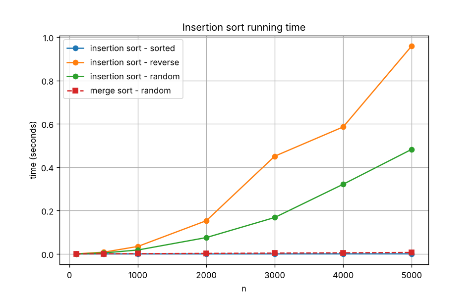

# Empirical Analysis of Insertion Sort

Mini project for CS314 (Analysis of Algorithms), lecture 1.

I wrote insertion sort, counted comparisons and shifts, and timed it on sorted,
reverse-sorted and random lists for n = 100 to 5000. I also timed merge sort on the random lists.

## How to run

```
pip install -r requirements.txt
python experiment.py
python test_insertion_sort.py
```

`experiment.py` prints the counts and times and saves `running_time.png`.

## Results (n = 5000)

| Input | Comparisons | Shifts | Time |
|---|---|---|---|
| sorted | 4,999 | 0 | 0.0004 s |
| reverse | 12,497,500 | 12,497,500 | 0.96 s |
| random | about 6.3 million | about 6.3 million | 0.48 s |



## What I noticed

- Sorted input is the best case: n - 1 comparisons and no shifts, so it is O(n).
- Reverse input is the worst case: n(n-1)/2 comparisons, so it is O(n²). For n = 5000 that is exactly 12,497,500.
  When n went from 1000 to 5000 (5 times bigger) the time went from 0.035 s to 0.96 s, about 27 times more, which fits n².
- Random input does about half of the worst-case work, which is still O(n²).
- Insertion sort needs no extra memory, but it is slow for big unsorted lists.
  Merge sort is O(n log n) and was much faster on the same random lists, but it needs extra memory.

The times depend on the computer. The counts do not.
